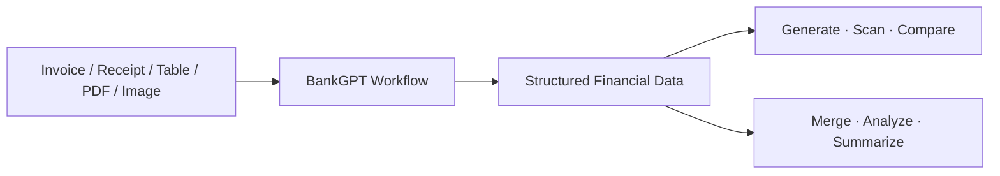

# BankGPT Skills

Official Agent Skills for [BankGPT](./) - generate, scan, compare, merge, and summarize financial data.

## What are Agent Skills?

Agent Skills are reusable instructions, references, and optional tools that teach an AI agent how to perform a workflow consistently. This repository maintains one canonical Skill source that works with Codex, Claude Code, and other Agent Skills-compatible tools.

## Available Skills

### bankgpt-workflow

Use this Skill for invoice generation, receipt and PDF scanning, table comparison, merge workflows, and AI summaries.

## Workflow



## Usage

Codex:

```text
Use $bankgpt-workflow to compare these spreadsheets and summarize the differences.
```

Claude Code standalone Skill:

```text
/bankgpt-workflow Generate an invoice from the attached data.
```

Claude Code Plugin:

```text
/bankgpt-workflow:bankgpt-workflow Merge these tables into one workbook.
```

## Supported Inputs

- pasted table, invoice, receipt, or bank-statement text
- attached `.pdf`, `.png`, `.jpg`, `.txt`, `.csv`, `.xlsx`, `.tsv`, or structured data files
- local file paths when the host agent has filesystem access

JSON input can contain rows, headers, totals, or other structured financial fields. Ambiguous schemas should be resolved by user selection rather than guesswork.

Raw audio or video inputs should be converted to structured data before this Skill analyzes them.

## Output Rules

- Only requested sections are generated.
- Missing totals, labels, row values, or account details are never guessed.
- Comparisons report mismatches, duplicates, and missing rows without inventing reconciliation results.
- Merge outputs preserve source row order unless the workflow explicitly asks for sorting.

## BankGPT

Use BankGPT to move financial data from source files to analyzed output.
