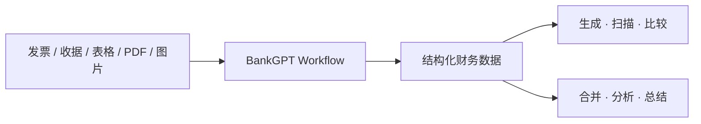

# BankGPT Skills

[BankGPT](./) 官方 Agent Skills - 生成、扫描、比较、合并并总结财务数据。

## 什么是 Agent Skills？

Agent Skills 是一组可复用的指令、参考资料和可选工具，用来让 AI Agent 按一致的流程完成任务。本仓库维护一份 canonical Skill 源码，同时支持 Codex、Claude Code 以及其他兼容 Agent Skills 的工具。

## 已发布 Skills

### bankgpt-workflow

用于发票生成、收据和 PDF 扫描、表格比较、合并工作流以及 AI 总结。

## 工作流程



## 使用方式

Codex：

```text
Use $bankgpt-workflow to compare these spreadsheets and summarize the differences.
```

Claude Code Standalone Skill：

```text
/bankgpt-workflow Generate an invoice from the attached data.
```

Claude Code Plugin：

```text
/bankgpt-workflow:bankgpt-workflow Merge these tables into one workbook.
```

## 支持的输入

- 直接粘贴表格、发票、收据或银行对账单文本
- 上传 `.pdf`、`.png`、`.jpg`、`.txt`、`.csv`、`.xlsx`、`.tsv` 或结构化数据文件
- 宿主 Agent 拥有文件系统权限时提供本地文件路径

JSON 输入可以包含行、表头、总计或其他结构化财务字段。遇到多个无法判断的候选字段时会询问用户，不会擅自合并或猜测。

原始音频或视频输入需要先转换成结构化数据，再交给该 Skill 分析。

## 输出规则

- 只生成用户要求的部分。
- 不猜测缺失的总额、标签、行值或账户信息。
- 比较结果只报告不匹配、重复和缺失项，不会凭空补全对账结论。
- 合并输出默认保留源数据行顺序，除非工作流明确要求排序。

## BankGPT

使用 BankGPT 将财务数据从源文件推进到分析结果。
